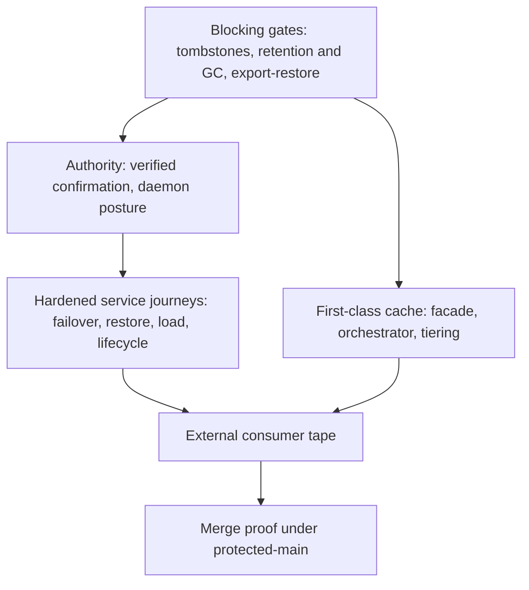

> Evidence: S01 S02 S03 S04 S05 S06 S07 S08 S09 S10 S11 S12 S13 S14 S15
> S16 S17 S18 S19 S20 S21 S22 S23 S24 S25 S26 S27 S28 S29 S30 S31 S32
> S33 S34 S35 S36 S37 S38 S39 S40 S41 S42 S43. Primary URLs:
> `../evidence/SOURCES.md`.

# Logical-DB First-Class Finish - Plan

## Goal Capsule

- **Objective:** Close every remaining production and handoff gate so Logical-DB is first-class and ready to move forward, and land the CloudKit-grade cache experience on top of the finished substrate.
- **Authority:** `AGENTS.md` is the engineering contract, `ARCHITECTURE.md` is the locked architecture, `REWRITE_MANIFEST.md` is the mechanical acceptance list, `docs/API_BOUNDARY.md` is the app-visible surface.
- **Execution:** code. Black-box journeys prove each gate; unit tests alone never close a gate.
- **Stop conditions:** All `REWRITE_MANIFEST.md` blocking boxes checkable, the verifier is green, and an external consumer uses only the public facade.
- **Tail ownership:** Remove abandoned-attempt code before declaring done; no dead-end scaffolding ships in the diff.

---

## Product Contract

### Summary

This plan finishes Logical-DB by closing its six blocking gates (external consumer proof, authority confirmation, log lifecycle, tombstones with export and restore, hardened service journeys, merge proof) and then ships the first-class cache experience (typed cache facade, sync orchestration, large-value tiering) that the prior ideation specified.

### Problem Frame

The clean-room rewrite proved the core: embedded edits, convergence over in-process and real HTTP paths, bounded sync, FDB adapter behavior, and hostile-review clearance. What remains is everything that makes a substrate shippable rather than merely correct. Deleted documents have no representation, so the log grows without bound and there is no export story. The daemon cannot authorize writes because its authority is self-asserted. No consumer outside this repository has ever used the facade. And the application-facing surface is still a raw document editor, so every app re-solves key mapping, expiry, batching, and retry. Each gap is a known gate, not a discovery.

### Requirements

**Log lifecycle and deletion**

- R1. A deleted document is represented as a first-class tombstone that converges across replicas and survives restart.
- R2. The service retains a versioned snapshot baseline and a retention floor, and prunes the append-only log only through peer-aware garbage collection that never removes state a live peer still needs.
- R3. A client that falls behind the retention floor recovers through an explicit recovery transition, never through silent divergence.

**Durability operations**

- R4. The embedded surface supports a versioned export and a restore contract, including interrupted-restore and corrupt-backup journeys that fail closed.
- R5. Multi-node FoundationDB failover and point-in-time restore are exercised against a real cluster, following the platform's own backup and restore mechanics.

**Authority and daemon posture**

- R6. Daemon write and synchronization authority is enabled only on independently verifiable, exact-request confirmation evidence, never on a locally asserted flag.
- R7. The daemon's default composition stays loopback-only and fail-closed; public network behavior lives in a separate composition owned by the deployment host.

**External proof**

- R8. An external-repository consumer packages and uses the facade without importing internal crates, proving the public boundary from the outside.
- R9. Sustained load with backpressure, disk exhaustion, sleep and wake, and mobile sandbox lifecycle are exercised as black-box journeys.

**First-class cache experience**

- R10. Applications get a typed cache facade with key mapping, time-to-live, and eviction, without touching document identity, operation identity, or projection plumbing.
- R11. Cache namespaces sync as independent domains with their own checkpoints and policies, so a hot namespace never starves a cold one.
- R12. A sync orchestrator owns batching, retry, and persisted state around the existing sync function, so apps enqueue changes and pull on demand instead of reimplementing the state machine.
- R13. Values larger than the change bound are tiered out of line with content addressing, transparent to cache readers.

**Release**

- R14. Only the reviewed result merges, every required job is observed green, and local, main, and origin tips match under protected-main policy.

### Actors

- A1. Application developer embedding the replica for local structured state.
- A2. Service operator running the multi-tenant synchronization service on FoundationDB.
- A3. External consumer (such as LEM) depending on the facade from another repository.

### Key Flows

- F1. Application lifecycle
  - **Trigger:** App opens, edits, deletes, exports, or restores its data.
  - **Actors:** A1
  - **Steps:** Open the scoped replica, apply edits with exact retry identity, delete through tombstones, export for backup, restore after failure.
  - **Outcome:** Local CRUD works offline with deterministic indexes, and every mutation is retry-safe.
  - **Covered by:** R1, R4, R10
- F2. Synchronization lifecycle
  - **Trigger:** Replica has pending changes or a hint that the upstream moved.
  - **Actors:** A1, A2
  - **Steps:** Bind one upstream, push pending changes, pull bounded pages, advance the checkpoint atomically, recover explicitly when the checkpoint expires.
  - **Outcome:** Two replicas converge with bounded pages and no lost delivery.
  - **Covered by:** R2, R3, R11, R12
- F3. Service lifecycle
  - **Trigger:** Operator deploys, backs up, fails over, restores, or authorizes the service.
  - **Actors:** A2
  - **Steps:** Serve bounded HTTP ingress, authorize against verified confirmation evidence, snapshot and retain, collect garbage peer-awarely, back up continuously, restore to a point in time.
  - **Outcome:** The service survives failover and restore with semantics intact.
  - **Covered by:** R2, R5, R6, R7, R9

### Acceptance Examples

- AE1. Delete then sync
  - **Covers:** R1
  - **Given:** A document synced to two replicas.
  - **When:** One replica deletes it and both synchronize.
  - **Then:** Both replicas report the document absent, and a late third replica that syncs also converges to absent rather than resurrecting the value.
- AE2. Behind the retention floor
  - **Covers:** R3
  - **Given:** A replica whose checkpoint predates the retention floor.
  - **When:** It attempts to pull.
  - **Then:** It receives an explicit checkpoint-expired signal and completes a full recovery transition instead of applying a partial prefix.
- AE3. Corrupt backup restore
  - **Covers:** R4
  - **Given:** An export whose bytes were corrupted after writing.
  - **When:** Restore is attempted.
  - **Then:** Restore refuses without touching live state, and reports the refusal.
- AE4. Cache put and expiry
  - **Covers:** R10
  - **Given:** A cache with a sixty-second time-to-live entry.
  - **When:** The entry is read before and after expiry.
  - **Then:** The first read returns the value and the second returns absent, with no manual eviction call.
- AE5. Oversize value round-trip
  - **Covers:** R13
  - **Given:** A value larger than the change bound.
  - **When:** It is cached, synced, evicted, and read on a second replica.
  - **Then:** Both replicas read identical bytes, and eviction removes the tiered bytes as well as the reference.

### Scope Boundaries

- The public application boundary in `docs/API_BOUNDARY.md` is preserved; storage handles and raw CRDT objects still never cross it.
- Public TLS termination stays a deployment-host boundary, not an embedded database function.
- No second database implementation and no second sync protocol; every journey drives the existing sync function and HTTP transport.
- Deferred to follow-up work: hierarchical sharing across scopes, push-notification infrastructure, queryable secondary predicates beyond the cache indexes.

### Dependencies

- A staged official FoundationDB 7.3.77 cluster for the failover and restore journeys, matching the previously proven staging.
- The platform backup and restore tooling (`fdbbackup`, `fdbrestore`, backup agents) for the point-in-time journey.
- An external consumer repository willing to host the consumer tape.

### Sources

- `AGENTS.md`, `ARCHITECTURE.md`, `REWRITE_MANIFEST.md`, `docs/API_BOUNDARY.md`, `evidence/SOURCES.md`, `experience/EXPERIENCE_TEST_REPORT.md`, `docs/ideation/2026-09-03-kv-cache-cloudkit-experience.md`.
- Apple CloudKit sync engine reference and delegate reference, retrieved 2026-09-04 via the project's named fetch combo.
- CloudKit best-practices notes on source-of-truth server with local cache, fetch-on-launch plus subscribe plus fetch-on-push, and notification coalescing.
- CloudKit subscription debugging notes on delivery exclusions and notification-change recovery.
- CloudKit web-services reference on asset upload token flow.
- FoundationDB backup and restore documentation on snapshot-plus-log point-in-time recovery and disaster-recovery replication.
- Automerge data-modeling guidance on document granularity and embedded schema versioning.

---

## Planning Contract

### Key Technical Decisions

- **Tombstones are a new stored kind with facade delete semantics.** A delete commits a tombstone marker through the same single-transaction discipline (snapshot, change, operation receipt, outbox, indexes, event) rather than erasing state, so convergence and acknowledgement keep working unchanged.
- **Export is a versioned logical dump, never a file copy.** The store refuses foreign files through replica binding, so export replays through the commit and install paths; restore is bounded before allocation and validated before commit.
- **Garbage collection is gated on live checkpoints and unconsumed operation records.** The service page invariant (gapless positions, more-while-behind-frontier) decides what is collectible; nothing referenced by an unexpired checkpoint or a pending operation record is pruned.
- **The cache crate sits above the facade and touches the verifier allow-list once.** Depending on the public facade plus the model crate keeps the one-way dependency discipline the verifier enforces; reaching into service, storage, or authority crates from the cache would violate layering.
- **Namespaces are independent sync domains with per-namespace checkpoints.** Isolating hot from cold traffic follows the proven zone pattern; sharing one checkpoint stream would let a chatty namespace starve the rest.
- **The sync orchestrator wraps the sync function instead of forking it.** Batching, backoff honoring retry hints, single checkpoint-expiry recovery, and opaque persisted state all live around the existing push-then-pull loop.
- **Large values split metadata from bytes at a fixed threshold.** Structured references stay inside the bounded change; content-addressed bytes live outside it and are removed transactionally after the referencing delete commits.
- **The daemon binary stays loopback-only.** Public network, multi-node, and sandbox journeys run through a separate composition or a test harness nesting the stateless router, so the shipped binary never stretches past its reviewed posture.
- **The external consumer tape lives outside the end-to-end crate.** That crate imports internal crates by design, so it cannot prove the public-only boundary; the tape is an external package using only the public surface.

### High-Level Technical Design

The substrate gates land first because the cache depends on deletion and recovery semantics. Authority work parallels the log lifecycle. Service journeys need retention and authority in place. The external tape comes after everything it consumes, and the merge proof closes the run.

### Risks and Dependencies

- The external consumer needs a host repository; if none is available the tape runs as a standalone external package that still imports only public crates, and the LEM handoff stays explicitly open.
- FoundationDB staging needs the same pinned client and server used previously; version drift reopens the adapter's transaction-ceiling assumptions.
- The cache crate adds a permanent public API; envelope versioning must land in the same unit so the first shipped shape is already forward-compatible.

---

## Implementation Units

| U-ID | Title | Files touched | Depends on |
|---|---|---|---|
| U1 | First-class tombstones | crates/logical-db, crates/logical-db-model, crates/logical-db-store, crates/logical-db-crdt | none |
| U2 | Snapshot baseline, retention, peer-aware GC | crates/logical-db-service, crates/logical-db-store-fdb, crates/logical-db-model | U1 |
| U3 | Export and restore contract | crates/logical-db, crates/logical-db-store | U1 |
| U4 | Verified confirmation and daemon posture | crates/logical-db-braid, crates/logical-db-daemon, crates/logical-db-server | none |
| U5 | Cache facade with TTL and eviction | crates/logical-db-kv (new), scripts/verify-rewrite.py | U1 |
| U6 | Namespace sync domains | crates/logical-db-model, crates/logical-db-sync, crates/logical-db-kv | U5 |
| U7 | Sync orchestrator | crates/logical-db-sync plus orchestrator placement | none |
| U8 | Large-value tiering | crates/logical-db-kv, crates/logical-db-platform | U5 |
| U9 | Hardened service journeys | crates/logical-db-e2e, crates/logical-db-server, crates/logical-db-http | U2, U4 |
| U10 | External consumer tape | external package, docs | U3, U5 |
| U11 | Merge proof | none (process) | U9, U10 |

### U1. First-class tombstones

- **Goal:** Deleting a document converges to absent everywhere, including on replicas that were offline at deletion time.
- **Requirements:** R1
- **Files:** `crates/logical-db/src/lib.rs`, `crates/logical-db-model/src/lib.rs`, `crates/logical-db-store/src/lib.rs`, `crates/logical-db-crdt/*`
- **Patterns:** Single-transaction commit discipline in the store; exact-retry short-circuit in the facade; conflict-candidate visibility in the reader.
- **Approach:** Add a stored tombstone kind on the existing key axis, expose delete through the facade with the same operation-identity recovery contract as edits, keep tombstones visible to conflict inspection while reads report absent, and carry tombstones through sync pages with the current bounds.
- **Test Scenarios:**
  - Delete syncs to a second replica and reads report absent on both.
  - A replica offline at deletion converges to absent when it later syncs, without resurrecting the value.
  - Duplicate delete with identical operation identity short-circuits without re-running.
  - Delete with a conflicting concurrent edit surfaces candidates while the visible result stays well-defined.
  - Restart between delete commit and sync preserves the tombstone.
- **Verification:** Targeted crate tests plus `cargo test --workspace --locked`; verifier green.

### U2. Snapshot baseline, retention, peer-aware GC

- **Goal:** The service can prune the log without ever removing state a live peer still needs.
- **Requirements:** R2, R3
- **Files:** `crates/logical-db-service/src/lib.rs`, `crates/logical-db-store-fdb/src/lib.rs`, `crates/logical-db-model/src/lib.rs`
- **Patterns:** Frontier-gated accept, checkpoint codec with expiry, gapless paging with more-while-behind-frontier.
- **Approach:** Version the snapshot baseline, enforce a retention floor on prune decisions, gate collection on unexpired checkpoints and unconsumed operation and chunk references, and route behind-floor clients into the explicit full-recovery transition.
- **Test Scenarios:**
  - Prune refuses a prefix still referenced by a live checkpoint.
  - Prune refuses a prefix with unconsumed operation records.
  - A behind-floor client gets checkpoint-expired and completes full recovery.
  - Chunk, manifest, and invocation cross-references stay consistent after collection.
  - Retention floor survives service restart.
- **Verification:** Service and FDB adapter test suites plus a staged-cluster collection journey.

### U3. Export and restore contract

- **Goal:** Applications can back up and restore embedded state with explicit failure behavior.
- **Requirements:** R4
- **Files:** `crates/logical-db/src/lib.rs`, `crates/logical-db-store/src/lib.rs`
- **Patterns:** Bounded-before-allocation inputs, migration page discipline for resumable scans, revision-checked finalization.
- **Approach:** Define a versioned export format replayed through the commit and install paths, support resuming an interrupted restore from its cursor, and refuse corrupt backups without touching live state.
- **Test Scenarios:**
  - Export then restore reproduces reads, indexes, and change cursors exactly.
  - Killing the process mid-restore resumes to completion on retry.
  - A corrupted backup is refused with live state untouched.
  - An oversized or unknown-version payload is refused before allocation.
  - Export includes tombstones so restored state stays converged.
- **Verification:** Facade and store test suites plus kill-during-restore journey.

### U4. Verified confirmation and daemon posture

- **Goal:** Daemon write and sync authority activates only on independently verifiable confirmation evidence.
- **Requirements:** R6, R7
- **Files:** `crates/logical-db-braid/src/lib.rs`, `crates/logical-db-daemon/src/main.rs`, `crates/logical-db-server/src/lib.rs`
- **Patterns:** Per-request authority binding to exact scoped facts and durable frontier; loopback-only default composition.
- **Approach:** Replace the self-asserted local authority path with externally prepared, human-confirmed grants carrying expiry and scan-versus-point-read distinction, keep write and sync refused without them, and keep public network behavior out of the shipped binary.
- **Test Scenarios:**
  - Write and sync are refused under the default composition.
  - A fabricated local flag is rejected as confirmation evidence.
  - An expired grant is refused.
  - A grant for one scope cannot authorize another scope.
  - Reusing a consumed grant is rejected.
- **Verification:** Braid, daemon, and server suites plus the live-HTTP authentication boundary journey.

### U5. Cache facade with TTL and eviction

- **Goal:** One-line cache puts, gets, deletes, and prefix scans with expiry handled by the substrate.
- **Requirements:** R10
- **Files:** `crates/logical-db-kv/src/lib.rs` (new), `scripts/verify-rewrite.py`
- **Patterns:** Facade edit and read closures, deterministic schema-bound projections, bounded resumable migration scans, plain-prefix requirement IDs.
- **Approach:** Map keys to deterministic document identity, store a versioned envelope carrying value bytes, expiry, and sequence, index expiry and recency through the schema migration path, generate operation identity internally, and drive eviction as a bounded index-range scan.
- **Test Scenarios:**
  - Put, get, delete, and prefix scan round-trip without caller-supplied identity.
  - Expired entries read as absent after bounded eviction.
  - Envelope from an older writer still reads under a newer reader with new fields defaulted.
  - Values near the bound are refused with a typed error before commit.
  - The dependency verifier passes with the new crate registered.
- **Verification:** New crate suite plus verifier green.

### U6. Namespace sync domains

- **Goal:** A hot cache namespace never starves a cold one during sync.
- **Requirements:** R11
- **Files:** `crates/logical-db-model/src/lib.rs`, `crates/logical-db-sync/src/lib.rs`, `crates/logical-db-kv/*`
- **Patterns:** Per-scope checkpoint codec with expiry, bounded page limits, gapless paging.
- **Approach:** Partition sync state per namespace so each carries its own checkpoint and policy (page budget, network condition), letting frequently-changing namespaces sync independently of archival ones, with an explicit reverse catch-up path for cold devices.
- **Test Scenarios:**
  - Syncing one namespace advances only its checkpoint.
  - A chatty namespace under continuous writes does not delay convergence of a quiet namespace.
  - A fresh device receives the newest keys of a namespace first, then backfills.
  - A per-namespace atomic multi-key write applies all or nothing.
  - An expired namespace checkpoint recovers through the same explicit transition as the global one.
- **Verification:** Sync and model suites plus a two-namespace HTTP convergence journey.

### U7. Sync orchestrator

- **Goal:** Applications enqueue cache changes and pull on demand without reimplementing sync state.
- **Requirements:** R12
- **Files:** `crates/logical-db-sync/src/lib.rs`, plus orchestrator placement per the facade decision (`crates/logical-db-kv` or a new sync companion module)
- **Patterns:** Bind-upstream then push-then-pull loop, cancellation between atomic operations, retryable-versus-permanent transport classification, bounded page limits.
- **Approach:** Wrap the existing sync function with pending-change intake, page looping on the more signal, single checkpoint-expiry recovery, backoff honoring retry hints, and an opaque state blob the app persists across launches, with explicit fetch-now and send-now entry points.
- **Test Scenarios:**
  - Enqueued changes send without the app driving pages.
  - A multi-page backlog drains across successive runs until the more signal clears.
  - Checkpoint expiry triggers exactly one full recovery, and a second expiry surfaces as a protocol error.
  - Retryable transport failures back off and then succeed; permanent failures surface immediately.
  - Persisted state restored after process death resumes without duplicate delivery.
- **Verification:** Sync suite plus two-replica HTTP convergence journey.

### U8. Large-value tiering

- **Goal:** Oversize cache values round-trip and sync identically to small ones.
- **Requirements:** R13
- **Files:** `crates/logical-db-kv/*`, `crates/logical-db-platform/*`
- **Patterns:** Content-addressed sidecar references, per-OS data-root placement, transactional removal after referencing commit.
- **Approach:** Keep values under a fixed threshold inline, tier larger bytes to addressed blobs with a sidecar reference inside the bounded change, stream reads from the blob store, chunk sync transfer within page bounds, and delete tiered bytes once the referencing delete commits.
- **Test Scenarios:**
  - A value above the threshold round-trips byte-identical on two synced replicas.
  - Eviction removes both the reference and the tiered bytes, leaving no orphans after a crash between the two steps (recovered by sweep).
  - A missing blob fails a read loudly instead of returning partial bytes.
  - Small values never touch the blob path.
- **Verification:** Cache suite plus crash-between-commit-and-sweep journey.

### U9. Hardened service journeys

- **Goal:** The service posture is proven under failure and pressure, not just in unit suites.
- **Requirements:** R5, R9
- **Files:** `crates/logical-db-e2e/*`, `crates/logical-db-server/src/lib.rs`, `crates/logical-db-http/src/lib.rs`
- **Patterns:** Real router over loopback with real transport, semaphore admission with retry hints, strict media-type and bound enforcement.
- **Approach:** Drive multi-node failover, point-in-time backup and restore with the platform tools, sustained load against the admission bound, disk exhaustion, sleep and wake, and sandbox lifecycle as black-box journeys reusing the existing throttle and deadline contract.
- **Test Scenarios:**
  - Killing a cluster node during writes preserves convergence with no lost delivery after failover.
  - A continuous backup restores the service to a chosen point in time.
  - Load past the in-flight bound receives retryable pressure signals and drains when load stops.
  - Disk exhaustion fails writes loudly without corrupting committed state.
  - Sleep and wake plus sandbox restart resume sync without manual repair.
- **Verification:** End-to-end suite against the staged cluster.

### U10. External consumer tape

- **Goal:** Prove the public boundary from outside this repository.
- **Requirements:** R8
- **Files:** External package (new, outside this repo); `docs/` note recording the tape
- **Patterns:** Public facade plus HTTP transport only; black-box two-replica convergence shape.
- **Approach:** Build a minimal consumer in a separate repository that opens, edits, deletes, indexes, exports, and synchronizes using only the published public crates, and record the journey as evidence.
- **Test Scenarios:**
  - The consumer compiles against the published surface with no internal-crate imports.
  - Its two replicas converge over real HTTP including a delete.
  - Its export restores into a fresh replica.
  - The tape fails if any internal path leaks into the consumer's dependency graph.
- **Verification:** Consumer test run plus dependency-graph audit.

### U11. Merge proof

- **Goal:** Only the reviewed result lands, observably.
- **Requirements:** R14
- **Files:** none
- **Approach:** Merge the reviewed result, observe every required job, and prove the three tips match under protected-main policy.
- **Test Scenarios:**
  - The verifier, workspace tests, clippy, formatting, and dependency policy are all observed green on the merged commit.
  - Local, main, and origin tips match after merge.
- **Verification:** CI output and tip comparison.

---

## Verification Contract

| Command | Applies to | Proves |
|---|---|---|
| `cargo test --workspace --locked` | U1–U9 | Runtime behavior and restart journeys |
| `cargo check --workspace --all-targets --locked` | U1–U9 | Compilation across all targets |
| `cargo clippy --workspace --all-targets --locked -- -D warnings` | U1–U9 | Lint-clean with warnings denied |
| `cargo fmt --all -- --check` | U1–U9 | Formatting discipline |
| `python3 scripts/verify-rewrite.py` | U1–U9, required for U5 | Evidence tags, dependency discipline, churn gates |
| `cargo deny check` | U1–U9 | Advisory, license, and source policy |
| Staged-cluster journeys | U2, U8 | Failover, restore, collection under a real cluster |

---

## Definition of Done

- Every requirement R1–R14 is met by its unit's scenarios, proven by commands in the Verification Contract rather than by inspection.
- The verifier, workspace tests, clippy, formatting, and dependency policy are green on the merged result.
- No abandoned-attempt or experimental code remains in the diff.
- The external consumer tape passes from outside the repository.
- The merge proof records green jobs and matching tips.

---

## Appendix

### Research method

External research for this plan ran exclusively through the project's named 9Router combos: search combo for discovery across five queries (sync engine, zones with assets, subscriptions, FoundationDB operations, tombstone patterns) and fetch combo for seven retrievals. Stack OverflowDien blocked one retrieval with a 403; the corresponding design point (asset tiering mechanics) was instead grounded in the CloudKit web-services asset-upload reference.

### Load-bearing findings

- The sync engine reference establishes the wrap-don't-fork shape: the engine owns opaque persisted state, the app enqueues pending changes, the delegate supplies batches on demand, and explicit fetch and send cover immediacy. U6 mirrors this exactly.
- The best-practices notes establish server-as-source-of-truth with local cache plus fetch-on-launch, subscribe, and fetch-on-push, with coalesced notifications as hints rather than delivery. The plan keeps checkpoints as truth and treats any future push strictly as a pull hint.
- The subscription debugging notes establish the recovery path (notification-change fetch) and the delivery exclusions (originating device, force-quit, simulator). Any subscription work deferred past this plan inherits these constraints.
- The FoundationDB documentation establishes snapshot-plus-change-log as the point-in-time mechanism and continuous backup plus disaster-recovery replication as the lagging-consistent-secondary shape. U8 follows the platform tools rather than inventing service-side backup.
- The Automerge guidance establishes document granularity as the unit of collaboration and embedded schema versions with idempotent migration. U5 applies both to cache keys and envelopes.
- Local research established the verifier as the hard placement constraint for the new crate, the e2e crate as unsuitable for the external tape, the daemon binary as un-stretchable to public networking, and export-via-file-copy as refused by replica binding. Each became a Key Technical Decision above.
